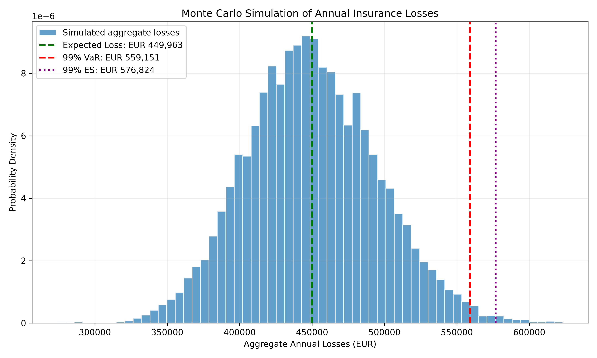
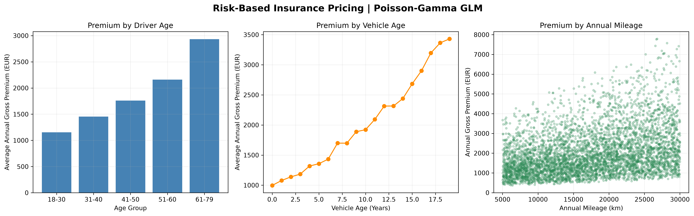

# Non-Life Insurance Pricing & Risk Analytics

An actuarial modeling project using Python to simulate insurance claims, estimate premiums, and quantify portfolio risk through Monte Carlo simulation.

## Project Overview

This project demonstrates fundamental actuarial techniques for non-life insurance pricing and quantitative risk management.

The model covers:

- Claim frequency modeling using the Poisson distribution
- Claim severity modeling using the Gamma distribution
- Pure premium and gross premium calculation
- Monte Carlo simulation of aggregate annual losses
- Value at Risk (VaR) and Expected Shortfall (ES)
- Visualization of portfolio loss distributions

## Mathematical Framework

### 1. Claim Frequency

The annual number of claims per policy follows a Poisson distribution:

\[
N_i \sim \operatorname{Poisson}(\lambda)
\]

where:

- \(N_i\): annual claim count for policy \(i\)
- \(\lambda = 0.15\): expected annual claim frequency

The portfolio consists of 1,000 policies.

### 2. Claim Severity

Individual claim amounts follow a Gamma distribution:

\[
X_j \sim \operatorname{Gamma}(\alpha,\theta)
\]

with:

- Shape parameter: \(\alpha = 2\)
- Scale parameter: \(\theta = 1500\)

Expected claim severity:

\[
E[X] = \alpha\theta = 3000
\]

### 3. Aggregate Loss Model

Annual aggregate portfolio losses are modeled as:

\[
S = \sum_{j=1}^{N} X_j
\]

where \(N\) is the total annual claim count.

Under the independence assumptions of the compound Poisson model:

\[
E[S] = E[N]E[X]
\]

The theoretical expected annual portfolio loss is EUR 450,000.

### 4. Insurance Premium Calculation

The pure premium per policy is:

\[
P_{\text{pure}} = \lambda E[X] = 450
\]

The illustrative gross premium includes a 10% risk loading on the pure premium and a 20% expense loading on the gross premium:

\[
P_{\text{gross}}
= \frac{P_{\text{pure}}(1+0.10)}{1-0.20}
= 618.75
\]

### 5. Monte Carlo Risk Analysis

The project simulates 10,000 annual portfolio loss scenarios.

The 99% Value at Risk is estimated as:

\[
VaR_{0.99}(S) = F_S^{-1}(0.99)
\]

The 99% Expected Shortfall is estimated as the average simulated loss in the upper 1% tail:

\[
ES_{0.99}(S)
= E[S \mid S \ge VaR_{0.99}(S)]
\]

## Risk Visualization



The chart illustrates the simulated annual aggregate loss distribution, expected losses, 99% VaR, and 99% Expected Shortfall.

## Risk-Based Premium Analysis

This project extends traditional actuarial pricing with
Generalized Linear Models (GLMs) for claim frequency
and severity.

A Poisson GLM estimates annual claim frequency, while
a Gamma GLM with a log link estimates expected claim
severity.

The models use synthetic policyholder characteristics:
- Driver age
- Vehicle age
- Annual mileage
- Policy exposure

Predicted claim frequency and severity are combined
to calculate individual risk-based insurance premiums.



The visualization illustrates how estimated gross
premiums vary across driver age, vehicle age,
and annual mileage.

All results are based on synthetic data and are
intended for educational and analytical purposes.


## Technologies

- Python
- NumPy
- Pandas
- SciPy
- Statsmodels
- Matplotlib
- GitHub Actions

## Project Structure


non-life-insurance-pricing-python/
├── .github/
│   └── workflows/
│       └── python-tests.yml
├── figures/
│   └── risk_based_premium_analysis.png
├── src/
│   ├── claim_frequency.py
│   ├── claim_severity.py
│   ├── premium_calculation.py
│   ├── monte_carlo_risk.py
│   ├── risk_visualization.py
│   ├── frequency_glm.py
│   ├── severity_glm.py
│   ├── risk_based_pricing.py
│   └── premium_visualization.py
├── tests/
│   └── test_actuarial_models.py
├── aggregate_loss_distribution.png
├── requirements.txt
└── README.md


## Installation

Install the required Python packages:

```bash
pip install -r requirements.txt
```

## Usage


Run the individual actuarial models:

```bash
python src/claim_frequency.py
python src/claim_severity.py
python src/premium_calculation.py
python src/monte_carlo_risk.py
```

Fit the Generalized Linear Models:

```bash
python src/frequency_glm.py
python src/severity_glm.py
```

Generate risk-based insurance premiums:

```bash
python src/risk_based_pricing.py
```

Generate the visualizations:

```bash
python src/risk_visualization.py
python src/premium_visualization.py
```

The visualization scripts save their outputs in
the `figures/` directory.

Run the unit tests:

```bash
python -m unittest discover -s tests -p "test_*.py" -v
```

GitHub Actions automatically executes the models
and tests and uploads the generated results
as workflow artifacts.


## Model Limitations

This is an educational actuarial model based on synthetic data.

The model assumes independent claim occurrences and severities, constant portfolio parameters, and simplified premium loadings. It does not represent a production insurance pricing system.

## Future Extensions


## Future Extensions

- Model validation using holdout datasets
- GLM diagnostics and residual analysis
- Sensitivity and scenario analysis
- Parameter uncertainty and bootstrap methods
- Improved automated tests for model implementations
- Comparison of alternative pricing models
- Portfolio profitability and loss ratio analysis
- Interactive actuarial analytics dashboard


